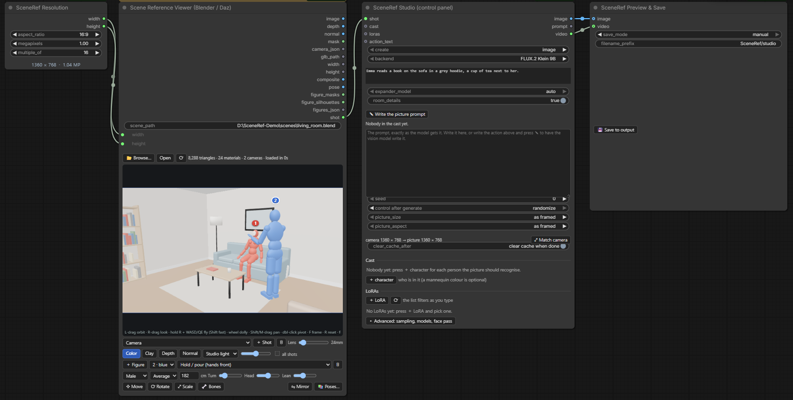
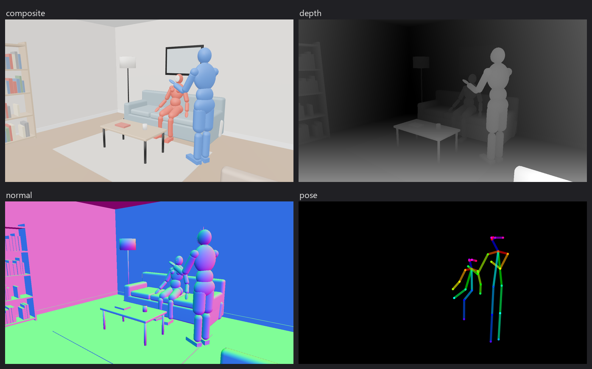
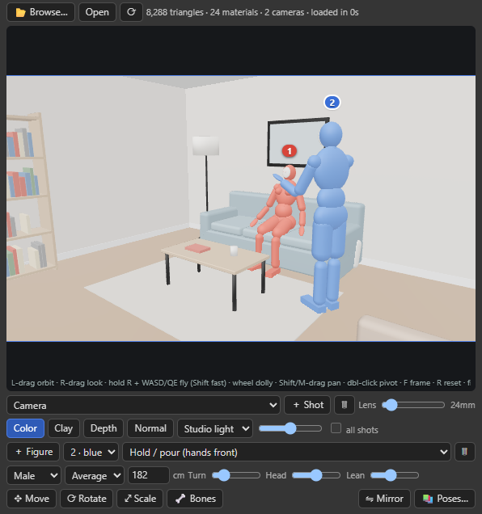
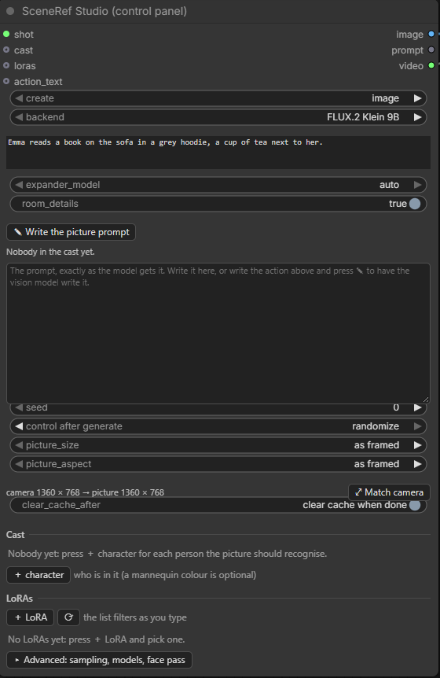

# SceneRef for ComfyUI

**Stage a shot in 3D, then let an image or video model film it.**

SceneRef opens **Blender (`.blend`)** and **Daz Studio (`.duf`)** scenes right on a ComfyUI node. You
walk through the scene, place and pose people, frame the shot, and the node hands the exact view
(colour, depth, normals, masks, poses, camera) to the model as a reference. No 3D scene? Photos of a
place work too.



The **SceneRef Studio** node then does the rest in one place: who is in the picture (from `.char`
files, DaSiWa RefMods or plain photos), the LoRAs, a vision model that writes the prompt, and the
whole generation graph for **FLUX.2 Klein 9B**, **FLUX.3 Klein**, **Qwen-Image 2.1 + ControlNet**,
**Krea 2 + identity edit**, **MOSS-Image + scene control** or **MiniMax H3** (movies with sound and voices).

> **Status:** an early public release by one person, tested on Windows 11 with a 16 GB NVIDIA card,
> ComfyUI 0.43 and its new frontend (Nodes 2.0 on and off). The Blender side is cross-platform; the
> Daz Studio side is Windows-first. Issues and pull requests are welcome.

## What's in it

| node | what it does |
|---|---|
| **Scene Reference Viewer (Blender / Daz)** | opens a `.blend` / `.duf` / `.glb` in a 3D view on the node; mannequins and Daz figures for people, a pose library, move / rotate / scale / bone gizmos, saved shots. Outputs the view and everything below |
| **SceneRef Scene (pictures)** | the same `shot` from photos of a place: one main view (the camera) and other angles |
| **SceneRef Scene Maker (.scene)** | saves a place (pictures + description) as a `.scene` file |
| **SceneRef Studio (control panel)** | one node instead of a whole graph: cast, LoRAs, ✎ prompt writer, picture or movie, every backend |
| **SceneRef Character (.char / RefMod / pictures)** | one person for the Studio, from a `.char`, a RefMod or photos, with an optional voice |
| **SceneRef Character Maker (.char)** | makes an OmniChar-compatible `.char` from photos, with an optional AI description and voice |
| **SceneRef RefMod Maker (MiniMax H3)** | makes a DaSiWa-compatible RefMod (H3 latents, optional voice) |
| **SceneRef Prompt Expander (vision)** | a vision model turns a short action into full scene directions, for your own graphs |
| **SceneRef LoRA Stack** | LoRAs with on/off, strength and trigger words found automatically |
| **SceneRef Resolution** | width / height from an aspect ratio and megapixels |
| **SceneRef Preview & Save** | preview first, save to `output` when you like it (or always) |

What the viewer outputs:



| output | what it is |
|---|---|
| `image` | the view in colour (or plain clay), at `width` × `height`, without people |
| `composite` | the view **with** the people (mannequins and Daz figures) in their colour tags |
| `depth` | depth map: near = white, far = black (normalised per picture, like MiDaS / Depth Anything) |
| `normal` | camera-space normal map (OpenGL: red → right, green → up, blue → towards you) |
| `mask` | white where there is geometry |
| `pose` | OpenPose (COCO-18) skeletons of every person, hidden joints left out |
| `figure_masks` / `figure_silhouettes` | one mask per person: the visible part / the whole body |
| `figures_json` | per person: colour, height, pose, distance, visible fraction, boxes, head box, facing, hidden parts |
| `camera_json` | position, rotation, FOV, 36 mm-equivalent focal length, depth range |
| `glb_path` | the converted scene (GLB), for other 3D nodes |
| `width`, `height` | the picture size, ready for an empty latent or a scheduler |
| `shot` | everything above in one wire, for the **SceneRef Studio** |
| `regions` | which object is where: one flat colour per object (a figure is one object), black = nothing or a speck. The colour map for MOSS-Image's colour/depth control |

`depth`, `normal` and `mask` include the people as shapes, so a depth ControlNet places the bodies
and the furniture that hides them.

---

## Contents

1. [Requirements](#requirements)
2. [Install](#install)
3. [Models](#models)
4. [Example workflows](#example-workflows)
5. [Using the viewer](#using-the-viewer)
6. [People in the scene: mannequins and Daz figures](#people-in-the-scene-mannequins-and-daz-figures)
7. [Scenes from pictures: SceneRef Scene](#scenes-from-pictures-sceneref-scene)
8. [SceneRef Studio: the control panel](#sceneref-studio-the-control-panel)
9. [How it works](#how-it-works)
10. [Preparing scenes: what to pay attention to](#preparing-scenes-what-to-pay-attention-to)
11. [Configuration](#configuration)
12. [Troubleshooting](#troubleshooting)
13. [Known limits](#known-limits)
14. [Responsible use](#responsible-use)
15. [License and credits](#license-and-credits)

---

## Requirements

| what | needed for | notes |
|---|---|---|
| A recent ComfyUI with the new frontend | everything | tested with ComfyUI 0.44 on Windows 11; FLUX.3 Klein needs 0.41.2 or newer, MOSS-Image 0.43 or newer |
| A WebGL2 browser (Chrome, Edge, Brave, Firefox) | the 3D viewer | the view is rendered **in the browser**, so a GPU-backed browser matters for big scenes |
| **Blender 4.2 or newer** | `.blend` files **and** `.duf` files | tested with Blender 5.1. Daz scenes are finished in Blender too |
| **Daz Studio 4.x** | `.duf` files | tested with Daz Studio 4.24 (Windows) |
| Python packages | none | nothing beyond ComfyUI itself. three.js r170 (MIT) is bundled in `vendor/` |

Optional extras:

| extra | for |
|---|---|
| [comfyui-krea2edit](https://github.com/lbouaraba/comfyui-krea2edit) (Apache-2.0) | the Krea 2 + identity edit backend |
| [ComfyUI-GGUF](https://github.com/city96/ComfyUI-GGUF) | `.gguf` FLUX.3 Klein models and text encoders |
| `opencv-python` and OpenCV Zoo's YuNet + SFace models (`face_detection_yunet_2023mar.onnx`, `face_recognition_sface_2021dec.onnx`, anywhere under `ComfyUI/models`) | the picture check of character photos (face crops, blur and duplicate warnings). Without them the photos are used as they are |
| llama.cpp's `llama-server` (a recent build) | `.gguf` FLUX.3 prompt upsamplers |

### Do Blender or Daz need to be open?

**No.** They only need to be **installed**. SceneRef starts them itself when a scene is converted:

* **Blender** runs in the background (`blender -b --factory-startup`) with no window, and closes
  when the conversion ends. An open Blender is not used and not touched.
* **Daz Studio** is started as a **separate, minimized instance** (`-instanceName #`).
  It loads the scene, exports it, and closes itself. A Daz Studio you already have open keeps
  running untouched: you can keep working in it, even on the same scene.
  Daz briefly shows a minimized window in the taskbar while it works. That's expected.
* Each converter runs one job at a time. A Blender conversion and a Daz conversion can run in parallel.
* After the first conversion the scene is **cached**, so later opens need neither program.

Daz must be able to start normally on this PC (installed, activated, logged in to Daz Connect if
your install requires it). If a plain Daz start shows a dialog, the conversion waits on it.

---

## Install

```bash
cd ComfyUI/custom_nodes
git clone https://github.com/AliC-2001/ComfyUI-SceneRef-Nodes.git
```

Then **restart ComfyUI** and reload the browser tab. The nodes are under **Add Node → SceneRef**.

Not in the ComfyUI Registry / Manager yet. To install by hand, copy (or link) this folder into
`ComfyUI/custom_nodes/`; any folder name works.

**Check the install:** with ComfyUI running, open `http://127.0.0.1:8188/scene_ref/tools` (use
your ComfyUI port). It shows the Blender and Daz Studio programs SceneRef found. If one is `null`,
set its path in the config (see [Configuration](#configuration)).

**Update:**

```bash
cd ComfyUI/custom_nodes/ComfyUI-SceneRef-Nodes
git pull
```

Restart ComfyUI, and reload the browser tab with **Ctrl+F5** so the new viewer code is used.
When the converter changes, cached scenes are converted again automatically on the next open.

---

## Models

No model is included. Each backend needs its own files in the usual `ComfyUI/models/` folders. The
Studio finds them by name (`auto`); if yours are named differently, pick them under **▸ Advanced**
(every model selector's tooltip says what it looks for). You only need the backends you use.

| backend | files (folder) |
|---|---|
| FLUX.2 Klein 9B | `flux-2-klein-9b.safetensors` (diffusion_models), `qwen_3_8b_fp8mixed.safetensors` (text_encoders), `flux2-vae.safetensors` (vae). ComfyUI's built-in *Flux.2 Klein 9B* templates download them |
| FLUX.3 Klein | `flux3-image-klein-int8-convrot.safetensors` (diffusion_models), a Qwen3-VL 4B text encoder such as `qwen3vl_4b_int8_convrot.safetensors` (text_encoders), `flux2-vae.safetensors` (vae), and for ✎ BFL's prompt upsampler `qwen3.5_9b_flux3_prompt_upsampler_*.safetensors` (text_encoders). See [FLUX.3 Klein](#flux3-klein) |
| Qwen-Image 2.1 + ControlNet | a Qwen-Image 2.1 model such as `qwen_image_2.1_int8_convrot.safetensors` (diffusion_models), `qwen3vl_8b_int8_convrot.safetensors` (text_encoders), `qwen_image_2.1_vae_bf16.safetensors` (vae), the Qwen-Image 2.1 Fun ControlNet Union (model_patches) |
| Krea2 + identity edit | `krea2_turbo_fp8_scaled.safetensors` (diffusion_models), `qwen3vl_4b_fp8_scaled.safetensors` (text_encoders), `qwen_image_vae.safetensors` (vae), `krea2_identity_edit_v1_2.safetensors` (loras), plus the comfyui-krea2edit nodes |
| MOSS-Image + scene control | from [Comfy-Org/MOSS-Image](https://huggingface.co/Comfy-Org/MOSS-Image): `moss_image_sft_int8_convrot.safetensors` or another MOSS-Image SFT file (diffusion_models), `qwen3.5_9b_w4a8_gptq.safetensors` (text_encoders), `flux2-vae_small.safetensors` (vae), `moss_image_color_depth_control.safetensors` and `moss_image_edit_lora_rank_64_bf16.safetensors` (loras). The face pass uses FLUX.2 Klein's files |
| MiniMax H3 (movies) | the H3 ref2va model (diffusion_models), `qwen3vl_32b_minimax_h3_*` (text_encoders), `minimax_h3_video_vae_fp16.safetensors` and `minimax_h3_audio_vae_fp32.safetensors` (vae) |
| ✎ prompt writer, AI descriptions | a Qwen3-VL 8B file that still has its `lm_head` weights, in `text_encoders` or `models/LLM` (see [The prompt](#the-prompt)) |

Every model comes with its own license; check it before you use the results.

---

## Example workflows

Seven come in `workflows/` (drag one onto the canvas, or **Workflow → Open**):

* **`workflows/SceneRef - Showcase.json`**: everything at once. Two people from `.char` files,
  the demo room `examples/living_room.blend` with two mannequins and a café from photos (`.scene`).
  An **If/Else Switch** picks the scene (on = the 3D room, off = the photos; only that one runs),
  one Studio makes a FLUX.2 Klein 9B picture or a MiniMax H3 movie, and the Character and Scene
  makers (muted) are there for your own. The room opens by itself (`scene_path` is
  `examples/living_room.blend`); pick the *Camera* in its camera list, and your own `.char` / `.scene`
  files.
* **`workflows/SceneRef - Studio.json`** (start here): **SceneRef Resolution** → **Viewer** →
  **SceneRef Studio** → **SceneRef Preview & Save**. Open a scene on the viewer (mannequins are
  optional); in the Studio pick *image* or *movie*, add the people in the **Cast** list (a
  `.char`, a RefMod, or pictures from your computer), write the `action`, Run. The Studio builds
  the whole generation graph itself and fills in the model files it finds. See
  [SceneRef Studio](#sceneref-studio-the-control-panel).
* **`workflows/SceneRef - Flux2 Klein reference.json`**: the same idea with every node in view,
  for building your own graphs. The rest of this section describes it.
* **`workflows/SceneRef - Studio movie with voices.json`**: the Studio set to *movie*, with a
  **SceneRef Character** node fed a face photo, a full-body photo and a voice recording. The
  person speaks with that voice in the MiniMax H3 clip. See [Voices](#voices).
* **`workflows/SceneRef - Character Maker.json`**: makes an OmniChar `.char` from photos and an
  optional voice, with an optional AI-written face and body description. See
  [Making a .char](#making-a-char-sceneref-character-maker).
* **`workflows/SceneRef - RefMod Maker.json`**: makes a DaSiWa RefMod (H3 latents plus an optional
  voice) from photos, a `.char` or another RefMod. See
  [Making a RefMod](#making-a-refmod-sceneref-refmod-maker).
* **`workflows/SceneRef - Scene from pictures.json`**: **SceneRef Scene** → **SceneRef Studio** →
  **SceneRef Preview & Save**: the Studio with photos of a place instead of a 3D scene. See
  [Scenes from pictures](#scenes-from-pictures-sceneref-scene).

`workflows/SceneRef - Flux2 Klein reference.json` takes the view on the node as the reference
for **FLUX.2 Klein 9B** (distilled, 4 steps) and turns it into a photo with the same layout
and camera angle. It also previews the depth and normal maps for later use with a ControlNet.

1. In ComfyUI, **drag the `.json` file onto the canvas**, or use **Workflow → Open**.
2. Check the model loaders. The workflow expects these files (the same ones ComfyUI's built-in
   *Flux.2 Klein 9B image edit* template uses, which can download them for you):

   | loader | file | folder under `ComfyUI/models/` |
   |---|---|---|
   | Load Diffusion Model | `flux-2-klein-9b.safetensors` | `diffusion_models/` |
   | Load CLIP (type `flux2`) | `qwen_3_8b_fp8mixed.safetensors` | `text_encoders/` |
   | Load VAE | `flux2-vae.safetensors` | `vae/` |

   If your files have other names or subfolders, just pick them in the dropdowns.
3. On the **Scene Reference Viewer** node, click **Browse…** and pick a `.blend` or `.duf`.
   The first open converts the scene, which takes minutes (see below). The status line shows progress.
4. Navigate to the shot you want (see [Using the viewer](#using-the-viewer)).
5. Edit the **Prompt** node: describe the photo you want, and keep the "same camera angle,
   same layout" instruction so Klein follows the reference.
6. Press **Run**. The result is saved under `output/SceneRef/`.

How the workflow is wired:

```
Scene Reference Viewer ─ image ─► Scale to 1 MP ─► VAE Encode ─► Reference Latent (+ and −)
                       ─ width/height ─► Flux2Scheduler (4 steps) + Empty Flux 2 Latent
                       ─ depth / normal / camera_json ─► previews
Prompt ─► Conditioning (+), ConditioningZeroOut (−) ─► CFG Guider (cfg 1) ─► SamplerCustomAdvanced ─► VAE Decode ─► Save
```

The viewer's outputs are ordinary `IMAGE` / `MASK` / `STRING` / `INT` sockets, so they plug into
any other workflow too: ControlNet (depth, normal), IP-Adapter, img2img, Qwen-Image edit, and so on.

---

## Using the viewer



### Navigation

Click inside the view first, so it gets keyboard focus.

| input | action |
|---|---|
| left drag | orbit around the pivot |
| right drag | look around (the camera stays where it is) |
| hold right + **W A S D**, **Q E** | fly forward / left / back / right, down / up (Shift = fast, Ctrl = slow) |
| wheel while holding right | change the fly speed |
| wheel | dolly towards the pivot |
| middle drag, or Shift + left drag | pan |
| double click | set the pivot on the surface you clicked |
| **F** | frame the whole scene |
| **R** | back to the scene camera |
| **1** **2** **3** **4** / **0** | move / rotate / scale / bones gizmo on the selected mannequin / off |

### Controls on the node

* **Browse…**: pick a file anywhere on the ComfyUI machine. You can also paste a path into `scene_path`.
  A relative path is looked up from the ComfyUI folder, then from this node pack's folder
  (`examples/living_room.blend` is the demo room).
* **Open / ⟳**: open the scene / force a fresh conversion (ignores the cache).
* **Cancel**: stops a running conversion.
* **Camera list**:
  * *free view*: wherever you navigated to.
  * the scene's own cameras: Blender cameras plus the 3D view the `.blend` was saved with
    ("Viewport (…)"), or Daz's viewport camera and scene cameras.
  * your saved shots.
* **＋ Shot / 🗑**: save the current view as a named shot / delete the selected shot.
* **Lens**: focal length, 36 mm-equivalent (horizontal).
* **Look**:
  * *colour*: textures, as Klein sees them.
  * *clay*: grey, shape only. Useful when textures would mislead the model.
  * *depth* / *normal*: preview what those outputs will contain.
* **Light**:
  * *studio* (default): soft, even light that shows shapes well.
  * *scene*: the lights from the file.
  * *flat*: no shading.
* **Exposure**: brightness of the colour view.
* **all shots**: render every saved shot in one Run, as an image batch (handy for storyboards).
  `camera_json` then holds one entry per shot.

Everything you set (current view, shots, lens, look, light) is stored **in the workflow**.
Saving and reopening the workflow restores the shot exactly.

### What happens when you press Run

The browser renders the current view at the node's `width` × `height` (independent of the
size of the node on screen), uploads the PNGs to ComfyUI's temp folder, and the node outputs them.
If the view hasn't changed, the uploads are reused. **The ComfyUI tab must be open** for this.
Queuing the workflow from a script or the bare API fails with *"no picture arrived from the browser"*.

---

## People in the scene: mannequins and Daz figures

Image models are bad at putting a person at the right spot, at the right size, behind the right
table. So you put the people into the 3D scene yourself, and the node hands the model an exact
picture of where each body is, how big it is and what covers it. People live in **world space**:
change the camera and they stay where you put them.

There are two kinds, and you can mix them (up to 8 people per scene):

| | mannequin | Daz figure |
|---|---|---|
| comes from | **＋ Figure** on the node | a character posed in the `.duf` (Genesis 3 / 8 / 9) |
| pose | 13 presets plus turn, head and lean | exactly the Daz pose, fingers included |
| moved by | dragging it in the view | posing it in Daz and saving the scene |
| looks like | jointed wooden-style mannequin in its colour | the Daz mesh in its colour, or with its Daz textures |

### Mannequins

* **＋ Figure** drops a mannequin on the surface in the middle of the view, facing the camera,
  in the first unused colour.
* **Drag** it (left button on the figure) to slide it over floors, seats, beds and counters. It
  stands on, or sits on, whatever is under the cursor. Seated poses put the hips on the seat and
  **snap onto the nearest seat**: drop a sitting figure on a sofa's backrest or front, or on the
  floor right in front of it, and it lands on the cushion (a flat surface 25–62 cm above the floor,
  within 80 cm).
* **Select** a figure by clicking it, or in the figure list. The selected one glows.
* Second row, for the selected mannequin:
  * **sex** (body shape) and **build** (slim / average / curvy / heavy),
  * **height in cm** (realistic proportions are derived from it),
  * **Turn** (which way it faces; also the **[** and **]** keys, Shift for 5° steps),
    **Head** (head turn) and **Lean**.
* **Pose presets:** Stand, Walk, Sit (chair, sofa), Sit leaning back, Sit on the floor, Lie on the back,
  Lie on the side (sleep), Kneel, Crouch, Reach forward, Hold / pour (hands front), Raise an arm,
  Lean on (counter, table). Many more in **📚 Poses…** (below).
* **🗑** or **Delete** removes the selected mannequin. **Esc** lets go of the joint, then deselects.

#### Gizmos: move, rotate, scale, bones

The third row (or the keys **1** to **4**, **0** for off) puts a gizmo on the selected mannequin.
Gizmos are only drawn in the view, never in the captured pictures.

| gizmo | key | what it does |
|---|---|---|
| **✥ Move** | 1 | arrows move along one axis, squares in a plane: lift a figure onto a bar stool, push it into a corner. Dragging the body itself still slides it over surfaces |
| **⟳ Rotate** | 2 | turn, and **tilt** the whole body: lying across a bed, leaning on a wall, upside down. The body stays on whatever it rests on |
| **⤢ Scale** | 3 | the height: any handle scales the whole figure (60 to 230 cm) |
| **🦴 Bones** | 4 | pose by hand: click one of the yellow joints, then turn it with the rings. Elbows and knees only bend the natural way |

Hold **Ctrl** while dragging to snap (5 cm, 15°, 5 %). With Bones on, **↺ Joint** puts the chosen
joint back to the preset, **↺ All** drops every hand-set joint, and **⇋ Mirror** swaps left and
right. Hand-set joints are stored in the workflow; picking another preset starts from that preset
again. A preset you adjusted shows as *Stand (adjusted)*.

#### The pose browser (📚 Poses…)

Click a pose to put it on the selected mannequin. The dialog stays open so you can try a few.

* **Library**: 115 poses from motion capture, by kind (standing, gestures, everyday, bending and
  reaching, exercise, action, walking and running, sitting, sitting on the floor, kneeling, lying,
  dance, music), with previews. See *Credits* below.
* **My poses**: poses you saved (**💾 Save pose** saves the selected mannequin's pose with a
  preview) and any pose files you put in `ComfyUI/models/poses/`.
* **Files**: any folder on disk, one level at a time, starting at the `People` folder of the open
  Daz scene's content library. It reads:
  * **Daz Studio pose presets** (`.duf`, Genesis 2, 3, 8, 8.1 and 9, plain and hierarchical) with
    their Daz preview pictures. The pose is worked out from the figure's own skeleton in your
    content library, the way Daz Studio does it (checked against Daz Studio itself). A partial preset
    (only a leg, only the arms) changes only those joints. Expression and hand-only presets are
    refused with a message.
  * **OpenPose** `.json` and **BVH** motion files (a few clearly different frames are offered).
* **OpenPose JSON**: drop files or paste JSON (`pose_keypoints_2d`, COCO-18 or BODY-25: OpenPose,
  the ControlNet preprocessors, openpose editors). You see the stick figure and the mannequin it
  became. A flat picture doesn't say whether a bone points towards the camera or away, so the lift
  guesses the natural way (knees forward, hands in front); fix the rest with the Bones gizmo.

Only the directions of the bones are used, so every pose fits every mannequin's height and build.
In the prompt, a library pose keeps its name with the posture (*"standing, waving"*); a pose whose
name reads like a code (*"MP G8F 02"*) is described by its posture (*standing, sitting, kneeling,
crouching, sitting on the floor, lying down*), worked out from where the joints are.

### Daz figures

Characters that are posed in a `.duf` are recognised automatically. A figure counts as a person when
its skeleton has a head, both hands and both feet, so rigged props (doors, fridges, drapes, a pair of
shoes on the floor) stay part of the room. Each person is exported **with everything that belongs
to it**: clothing, hair (including strand-based hair), geografts and props parented to it. It is
added to the figure list with its Daz name, for example *1 · red · Genesis 8 Female*.

* The second row shows a **Colour tag / Textured** switch instead of the body controls.
  * *Colour tag* (default) paints it in its figure colour, like a mannequin. The model then
    replaces it with whoever you describe, in exactly that pose.
  * *Textured* keeps the Daz skin, hair and clothes, for when the Daz character **is** the look you
    want.
* A Daz figure can't be dragged or deleted on the node: re-pose or hide it in Daz and save the scene.
  The next open converts it again.
* Its keypoints come from the real bones, so the `pose` output follows the Daz pose exactly.

### What the outputs give the model

* **`composite`**: the reference picture with the people in it. (The Studio does all of this
  for you.) Wire it into the model instead of `image` when there are people. In the prompt, refer to people by colour:
  *"Replace the red figure with a woman in a white dress, in the same pose. Replace the blue
  mannequin with …. Remove all mannequins."*
* **`pose`**: OpenPose skeletons for pose ControlNets. Joints that are behind furniture or out of
  the frame are left out, so the model isn't told to draw a leg through the table.
* **`figure_masks`** / **`figure_silhouettes`**: per person, the part you can see and the whole
  body. Use them for inpainting one person at a time, regional prompts or a face pass.
  One mask per person, in figure order. With *all shots* it is shot by shot.
* **`figures_json`**: what each person looks like in this shot, in numbers:

  ```json
  { "index": 1, "color": "red", "kind": "mannequin", "height_cm": 165, "pose": "sit",
    "pose_label": "Sit (chair, sofa)", "posture": "sitting", "distance_m": 3.04, "visible_fraction": 0.84,
    "bbox_visible": [197, 405, 396, 757], "head_box": [282, 397, 362, 477],
    "face_visible": true, "hidden_parts": ["left_leg"], "facing": "facing the camera" }
  ```

  Boxes are pixels in the output picture (`x0, y0, x1, y1`). `hidden_parts` lists the body parts
  that something covers, and `out_of_frame` the ones outside the picture.

### Who plays which figure: SceneRef Character

Usually you set this in the Studio's **Cast** list (see
[SceneRef Studio](#sceneref-studio-the-control-panel)); every field below is a column there. The
separate **SceneRef Character** node does the same for your own graphs. Add one per person and
chain them through `cast` (each node adds one character to the cast it receives), or wire each
into its own `cast` socket on the Studio (a new empty one appears whenever the last is wired):

```
Character (Emma, figure 1) ─cast─► Character (Jack, figure 2) ─cast─► SceneRef Studio
Character (Emma, figure 1) ─cast──────────────────────────────────────► SceneRef Studio (cast)
Character (Jack, figure 2) ─cast─────────────────────────────────────► SceneRef Studio (cast_2)
```

✎ *Write the prompt* reads these nodes too (their settings, and pictures from wired **Load Image**
nodes), so the prompt names everyone the Run gets.

**Naming them in the action or the prompt:** write the name, or its number: `@1`, `@2` ... are the
characters in order (the Studio's Cast list first, then `cast`, `cast_2` ...), and become their names
at ✎ and at Run (*"@1 sits left of @2"*). The line above the prompt box shows who is who:
*In the prompt: @1 Emma (cast) · @2 Jack (cast_2)*. A name is the `name` box, else the one
stored in the file with a version tag dropped (*Emma-sceneref-v1* → *Emma*).

| input | meaning |
|---|---|
| `source` | `char: …` an OmniChar `.char` file, `refmod: …` a DaSiWa RefMod, or *(pictures only)* |
| `figure` | the figure this character plays: 1 = red, 2 = blue, 3 = green, 4 = yellow, 5 = purple, 6 = orange, 7 = cyan, 8 = pink (0 = not tied to a figure) |
| `name` | empty = the name stored in the file |
| `description` | looks, clothes, age, added to the prompt. Empty = the pictures speak for themselves |
| `use_file_text` | also put the text stored in the `.char` / RefMod into the prompt (off by default: a stored "curly hair" can win over photos that show straight hair). On the Studio's cast cards the same tick fills the description box with that text, to edit |
| `max_refs` | how many reference pictures to use (default 3), split face : body : outfit = 2 : 1 : 1 when some must be left out |
| `face`, `body`, `outfit` | optional pictures, added to the file's pictures (or the only ones, with *pictures only*) |
| `refmod_vae` | only for RefMods: the MiniMax H3 video VAE. `auto` (default) finds `minimax_h3_video_vae_*` in `models/vae`; without RefMods the file isn't needed |
| `voice` | optional AUDIO: this person's voice for a movie (see [Voices](#voices)). Without it, a voice stored in the `.char` / RefMod is used |

* **`.char` files** go in `ComfyUI/models/characters/`. If you use OmniChar Studio, its
  `INLINE_CHARACTERS_DIR` folder is listed too. The node reads the description, the original
  pictures (or the stored reference sets when a file has no originals) with their roles (face /
  body / outfit), the voice if there is one, and any LoRA stored in the file, extracted once to
  `input/scene_ref_chars/`.
* **RefMods** go in `ComfyUI/models/refmods/` (single or bundle). They hold MiniMax H3 latents,
  not pictures, so the node decodes them **once** with the H3 video VAE (about 5 s per picture,
  then cached in `input/scene_ref_chars/`, and VRAM is freed straight away). An audio member is
  decoded with the H3 audio VAE and becomes the voice. The name ("Emma, a woman in her thirties …" →
  *Emma*) comes from the RefMod, and its text with `use_file_text`.
* Outputs: `cast`, a preview of the chosen pictures, and the prompt text this character adds. The
  text box on the node shows the picture check (below).

**The picture check.** Before the pictures reach a model, every one is looked at with OpenCV's
YuNet face detector and SFace face recogniser (the `face_detection_yunet_2023mar.onnx` and
`face_recognition_sface_2021dec.onnx` models, found anywhere under `ComfyUI/models`; without
them the pictures are used as given):

* **Small faces are cropped to the face.** A face photo whose face fills less than about a
  quarter of its height is cut to a square around the head (if that is at least 384 px), so the
  model gets the face, not the room. The full picture stays in the file.
* **Nothing is enlarged.** Pictures are only scaled down, to a short edge of 2048 and a long edge
  of 4096; each model then takes its own size (Klein `ref_megapixels`, H3 `h3_ref_size`), again
  only scaling down. An upscaled photo brings no detail, only a blurred copy.
* **Best first.** Sharper pictures with one clear face are taken before blurred ones.
* **Warnings** in the text box: no face found, several faces, blurred, *looks like someone else*
  (a picture far from the others; it goes last), *the same photo twice* (left out).
* **Roles.** RefMod pictures carry none, so a big face counts as *face* and the rest as *body*.
  A set with only body or outfit photos gets a face crop from its best picture added.

On the Studio's cast cards, **🔍 check** shows the same report without running anything.

### Making a .char: SceneRef Character Maker

`workflows/SceneRef - Character Maker.json` turns photos into an OmniChar `.char` file that the
Cast list, the Character node and OmniChar Studio all read.

1. **＋ picture** on the node (or wire IMAGEs into `face` / `body` / `outfit`), and set each
   picture's role. A few clear face photos from different angles and one full-body photo work best.
   Or pick a RefMod / `.char` as `source` to convert it (its pictures and text are copied).
2. Give it a `name` and, if you like, your own `description`.
3. `describe_with_ai` on: Qwen3-VL 8B (the expander's model) looks at the face pictures, then the
   body pictures, and writes a detailed face and body description (age range, face shape, eyes,
   hair, glasses, build, proportions, marks), added after your text. It is unloaded afterwards.
4. Optional: wire a **Load Audio** into `voice` (5 to 30 s of clear speech, no music). See
   [Voices](#voices).
5. Run. The file lands in `ComfyUI/models/characters/<name>.char` (`overwrite` off = `_2`, `_3` …).
   The node's text box shows what it saved and the [picture check](#who-plays-which-figure-sceneref-character).

The file is the one OmniChar Studio writes: the manifest first, the original pictures (short edge
up to 2048) with their roles, the description, ready-made reference sets for **FLUX.2 Klein** (up
to 1 MP, on a 16-pixel grid) and **MiniMax H3** (short edge up to 2048, 32-pixel grid), and the
voice in OmniChar's voice slot (the recording, plus a mono 32 kHz WAV for H3). Unlike OmniChar,
nothing is enlarged for a reference set. The check is reported, not applied: the file keeps the
original photos, and SceneRef crops the faces when it uses them. LoRA training is not done here;
open the file in OmniChar Studio for that.

### Making a RefMod: SceneRef RefMod Maker

`workflows/SceneRef - RefMod Maker.json` writes a DaSiWa RefMod bundle into
`ComfyUI/models/refmods/`, read by the Cast list, the Character node and DaSiWa's H3 Director.
Its pictures are stored as MiniMax H3 latents, so they are not encoded again on every movie.

* Pictures: **＋ picture**, the `face` / `body` / `outfit` inputs, or a `.char` / RefMod as `source`.
* The pictures go through the [picture check](#who-plays-which-figure-sceneref-character) first:
  the best `max_pictures` (default 4, 2 : 1 : 1), small faces cropped, at H3's "max" size (short
  edge up to 2048, never enlarged). DaSiWa stores the pictures as they come.
* `voice` (optional): stored as an audio member, cut to 15 s (DaSiWa's limit). Without it, a
  voice in the `source` is kept.
* `h3_vae`, `h3_audio_vae`: H3's video and audio VAEs. Encoding takes a few seconds per picture.

### Voices

A movie can give each person their own voice. MiniMax H3 takes up to **3** voice recordings.

* **Where a voice comes from:** a `.char` with a voice, a RefMod with an audio member, the
  `voice` input on a Character node, or the voice row on a Studio cast card: *voice from the
  file*, *no voice*, or a recording (**＋ voice** uploads one into `ComfyUI/input/scene_ref_voices/`).
* **What makes a good recording:** 5 to 30 s of one person speaking clearly, no music or other
  voices. It is made mono 32 kHz, the silence at both ends is cut, the level is evened out
  (clipping is reported), and it is cut to 30 s. Under 3 s of sound is refused.
* **Only people who speak use their voice.** When the prompt has someone's line (*Emma says:
  "…"*, also *Emma sits down, smiles and says: "…"* and *She says* right after Emma), the prompt gets
  OmniChar's wording, *"&lt;Audio 1&gt; is Emma's voice. Emma speaks in this voice, lips moving in sync
  with every word."*, and the recording is wired to H3 as `ref_audio_1`. A voice whose sentence
  you delete from the prompt is not sent; the others are renumbered.

### Tips

* Set the people **before** fine-tuning the camera: their size in frame is what the model copies.
* A person mostly hidden by furniture still gets the right size and position. The model sees
  the visible part, and `figure_silhouettes` knows the rest.
* Klein keeps placement well when the room is visible around the people. On an **empty backdrop**
  there is nothing to anchor the layout, and Klein may re-centre the people (pose, order and
  heights stay). Frame the people where you want them and keep some of the scene in view.

---

## Scenes from pictures: SceneRef Scene

Sometimes the place is a photo, a render from somewhere else or a painting, not a `.blend` or `.duf`.
**SceneRef Scene (pictures)** turns pictures of a place into the same `shot` the viewer gives, so it
plugs into the Studio's (or the Prompt Expander's) `shot` input instead of the viewer.

* **The main view** is the camera: the result keeps its angle, framing, furniture and objects. It is
  shrunk to `max_megapixels` (default 1, never enlarged, sides on a 16 grid); with the Studio's
  `picture_size` at *as framed* that is the picture size.
* **Other angles** (optional) are the same place seen from elsewhere. **MiniMax H3 movies** get up to 3
  of them right after the main view (*"&lt;Picture 2&gt; and &lt;Picture 3&gt; show the same place from other
  angles; the camera stays as in &lt;Picture 1&gt;."*), so the clip knows the place around the frame.
  **Picture models get them only with `angles_in_pictures` on** (up to 4). Off by default: in testing,
  FLUX.2 Klein tended to take the camera of an angle photo instead of the main view's (the same runs
  without angles kept the camera), whatever the prompt said and at any reference size.
* **Where the pictures come from:** **＋ picture** on the node (into
  `ComfyUI/input/scene_ref_pictures/`, each marked *main view* or *other angle*, only one main view),
  the `main_view` / `other_angles` inputs (Load Image or any other node; `other_angles` grows a new
  socket each time the last is wired, so pictures of different sizes need no batching), or a `.scene` file as
  `source`. The main view is the wired `main_view`, else the one marked on the node, else the file's,
  else the first picture.
* **`description`** (optional): the place in a few words (*"a small Paris kitchen, morning"*). It goes
  to the prompt writer with the `.scene` file's own text (`use_file_text`).
* **Nobody is placed.** A picture has no mannequins, so cast rows are not tied to figures here; say
  in the action who is where (*"Emma pours coffee at the counter, Jack reads by the window"*). The
  people come from the cast pictures as usual.

What each backend does with it:

| backend | the scene |
|---|---|
| FLUX.2 Klein, FLUX.3 Klein | main view = image 1, then the cast (with `angles_in_pictures`: the angles as images 2…, then the cast) |
| Qwen-Image 2.1 | the same, as `<image1>`, `<image2>` …; the ControlNet is off (a picture has no depth or pose) |
| Krea2 + identity edit | main view only (the edit takes one person picture per pass); each character is added where the text says |
| MOSS-Image | main view = image 1 (with `angles_in_pictures`: the angles next), then the cast, through the edit LoRA as an instruction (*"Add Emma, the person from image 2, to image 1 ..."*). The photo's framing is kept; the likeness is loose |
| MiniMax H3 movie | main view = `<Picture 1>`, up to 3 other angles = `<Picture 2>` …, then the cast (9 pictures in all) |

With the angles off, Klein keeps the photo's camera and puts the cast in it (about 25 s on a 16 GB
card); an H3 movie keeps the camera too, with the angles attached (about 250 s for 5 s at 0.4 MP).

✎ *Write the prompt* works as with the viewer: the vision model looks at the main view (FLUX.3's
upsampler also gets the angles when `angles_in_pictures` is on). It reads pictures added on the Scene node and pictures of
**Load Image** nodes wired to it. A picture made by another node exists only at Run, so ✎ asks you to
add it on the Scene node instead. The face pass needs a head box from a figure, so it does nothing here.

### Making a .scene: SceneRef Scene Maker

**SceneRef Scene Maker (.scene)** saves a place for later: the pictures (main view first, up to 12),
a name and a description, into `models/scenes/` next to `models/characters` (the shared models folder
with Comfy Desktop). `describe_with_ai` has the vision model (Qwen3-VL 8B, unloaded afterwards) write
the layout, materials, furniture and light from up to four of the pictures, after your own text.
`source` starts from another `.scene`. In the Scene node the file shows as `scene: <name>.scene`.

A `.scene` is a zip: `manifest.json` first (`"magic": "SCENEREFSCENE"`, each picture's path, size,
SHA-256 and role `main` / `angle`), the pictures in `pictures/` (PNG, short edge up to 2048) and
`text/description.md`.

---

## SceneRef Studio: the control panel



One node replaces the whole generation graph, and holds the cast, the LoRAs and the prompt
writer too. Wire the viewer's `shot` into it, fill it in, and Run:

```
SceneRef Resolution ─w/h─► Scene Reference Viewer ─shot─► SceneRef Studio ─image / video─► SceneRef Preview & Save
                                                            ├ create   image or movie
                                                            ├ action   what happens (for the prompt writer only)
                                                            ├ prompt   exactly what the model gets (✎ writes it)
                                                            ├ Cast     who is in it (mannequin colour optional)
                                                            └ LoRAs    on/off, strength, trigger words
```

Behind the scenes the Studio builds ordinary ComfyUI nodes (loaders, encoders, sampler, decode).
Models stay loaded between runs and progress shows as usual. It does not save anything itself:
wire `image` and `video` into **SceneRef Preview & Save**.

**`create` at the top picks what is made, and only that mode's settings are shown:**

* **image**: a picture from **FLUX.2 Klein 9B**, **FLUX.3 Klein**, **Qwen-Image 2.1 + ControlNet**,
  **Krea2 + identity edit** or **MOSS-Image + scene control**.
* **movie**: a clip with sound from **MiniMax H3 ref2va** (reference to video). The scene as the
  viewer frames it is `<Picture 1>`, with mannequins, Daz people or nobody in it; the characters'
  pictures follow; the prompt directs everything else. No first frame is pinned and no picture is
  made first. MiniMax makes no pictures.

**On the node, top to bottom:**

| setting | meaning |
|---|---|
| `create` | `image` or `movie`, see above |
| `backend` | image: **FLUX.2 Klein 9B** (4 steps, fast, most photographic), **FLUX.3 Klein** (16 steps; its prompt is a full scene caption from BFL's prompt upsampler, see [FLUX.3 Klein](#flux3-klein)), **Qwen-Image 2.1 + ControlNet** (25 steps; the Qwen-Image 2.1 Fun ControlNet Union holds every body exactly where its figure stands), **Krea2 + identity edit** (one pass per person, see below) or **MOSS-Image + scene control** (25 steps; the room and the bodies come through MOSS's colour/depth control, the faces from the face pass, see [MOSS-Image](#moss-image)) |
| `action` | what happens and how it should look, for the prompt writer only (it never goes into the prompt itself): *"Emma sleeps on the couch in a grey hoodie. Jack pours coffee at the table. Late night, light from the TV."* Name people as in the cast. For a movie: in order, speech in quotes after *says / asks*, camera moves if any |
| `expander_model`, `room_details` | the vision model that writes the prompt, and whether it may add small objects and describe the light |
| **✎ Write the prompt** and the prompt box | see [The prompt](#the-prompt) below. Drag the box's corner to make it bigger |
| `seed` | fixed = the same result again |
| `picture_size`, `picture_aspect` | image: the output's size (`as framed` = the viewer's width × height, or 0.5-4 MP) and shape (crops the camera view around its centre). Independent of how the viewer renders the reference |
| `movie_seconds`, `movie_size`, `movie_aspect` | movie: length (24 fps, rounded up to H3's 17-frame steps: 5 s = 124 frames; trained on about 5-15 s), size (0.4 MP default, as in ComfyUI's H3 template; 0.9 MP is about 720p and much slower) and shape |
| size line, **⤢ Match camera** | shows the camera's size and what will come out; the button sets the shape (and, for pictures, the size) back to the camera's own |
| `clear_cache_after` | on (default): once the run is done, ComfyUI unloads every model and forgets its cached node results, as its own *Free memory* button does. Off = faster re-runs with the models kept loaded |
| **Cast** | one card per person: on/off, optionally the mannequin they play (colour dot; *no figure* = placed by the text), the source (`.char`, RefMod or *pictures only*), name, how many pictures to use, a description, *also use the text stored in the file* (ticking it puts the file's text in the description box to edit; unticking empties the box), **＋ picture** for face / body / outfit photos from your computer (copied into `ComfyUI/input/scene_ref_pictures/`), the voice row (see [Voices](#voices)), and **🔍 check** for the picture check |
| **LoRAs** | the same list as the [LoRA Stack](#sceneref-lora-stack): ＋ LoRA opens ComfyUI's list with its filter box, on/off, strength, trigger words. In movie mode they go onto the H3 model. Nothing is added for you: a turbo LoRA is one you put in the list |
| **▸ Advanced** | the rest of the table below |

**Advanced:**

| setting | meaning |
|---|---|
| `steps`, `cfg`, `sampler_name`, `scheduler` | sampling, filled in with the model's usual values when you pick a backend or mode, then yours to change: Klein 4 / 1.0 / euler / `flux2` (Klein's own schedule, which follows the picture size), FLUX.3 Klein 16 / 1.0 / euler / simple (BFL's workflows), Qwen 25 / 1.0 / euler / simple, Krea2 10 / 1.0 / euler / simple, MOSS-Image 25 / 3.0 / er_sde / simple (ComfyUI's MOSS templates), movie 20 / res_multistep / simple (ComfyUI's H3 template; a turbo model or LoRA needs fewer, e.g. 8). `cfg` is for pictures: H3 samples without CFG, as in ComfyUI's template |
| `control_strength`, `control_mode` | Qwen only: how hard the ControlNet holds the layout (0 = off), and what it follows: `depth` (default), `pose`, or both |
| `ref_megapixels` | FLUX.2 Klein only: size of each character picture (FLUX.3 Klein takes them at 1 MP, as BFL's workflows do; neither enlarges a picture) |
| `face_pass` | on by default: after the picture is made, redo each visible face that belongs to a character on a mannequin, close up, from that character's face pictures only (FLUX.2 Klein, about 3 s per face; with FLUX.3 and no FLUX.2 Klein installed, FLUX.3 does it). Heads under about 96 px across are left as they are: blown up that far, the redone face came out bigger than the head. Klein, Qwen and MOSS-Image (where it is what gives people their faces) |
| `face_steps`, `face_denoise`, `face_sampler`, `face_scheduler` | the face pass's own sampling (8 / 0.75 / euler / flux2). Its short prompt (*"A close-up photograph of Emma, the person shown in image 1 …"*) is built for each face |
| `ref_boost` | Krea2 only: how strongly the person picture is followed (default 4) |
| `moss_control_strength`, `moss_control_end` | MOSS-Image: how hard and for how much of the run the depth and object map hold the scene (0.7 / 0.4; ComfyUI's template uses 1.0 / 0.6, which copies the mannequins' segmented limbs in close shots). 0 = off |
| `moss_regions`, `moss_layout` | on the node with MOSS-Image: give the control the object map too (on), and write the prompt as MOSS's JSON layout (off; see [MOSS-Image](#moss-image)) |
| `h3_ref_size` | movie: how big the character pictures go into H3: `match` (fast) or `max` (up to 2048 px, more likeness, several times slower) |
| model selectors | show the file the Studio found for each (the tooltip names what it looks for); pick another only if yours differ. `h3_video_vae` and `h3_audio_vae` are H3's VAEs for picture and sound |
| `cast`, `loras` sockets | optional: characters from Character nodes and LoRAs from a LoRA Stack, added to the lists on the node. `cast` grows: wire one and `cast_2`, `cast_3` ... appear (up to 8) |
| `action_text` socket | optional: wired text is used as the prompt, instead of the prompt box (e.g. from the separate Prompt Expander node) |

### The prompt

The prompt box is the prompt, **exactly as the model gets it**: the Studio adds nothing at Run,
not even the LoRA trigger words. Write it yourself, or let the vision model write it:

1. Write the `action`, set up the cast and LoRAs, frame the shot in the viewer.
2. Press **✎ Write the picture prompt** (or *movie prompt*). The vision model (Qwen3-VL 8B, from
   `models/text_encoders`) looks at the shot and writes the whole prompt for the chosen backend
   into the box, in about 10 s (more the first time, while it loads). The box's old text is
   replaced; **↶** brings it back.
3. Read it, change anything, then Run. After changing the action, the cast or the mannequins,
   press ✎ again (or edit the box): it does not update by itself.

What it writes, per backend (the parts that must be exact are built from the cast and the
mannequins; the vision model writes the scene, following that model's prompt guide):

* *Klein*: *"Image 1 is a 3D render of the scene. Turn it into the picture described below …
  Images 2 and 3 show Emma … Replace the red figure in image 1 with Emma, at exactly the same place
  and size, sitting, facing the camera."*, then the scene in prose (people and what they do, the
  setting, the light by its source and direction) ending with *Style: … Mood: …*
  ([FLUX.2 prompting guide](https://docs.bfl.ai/guides/prompting_summary)), then the trigger words.
* *FLUX.3 Klein*: BFL's prompt upsampler writes the whole caption, see [FLUX.3 Klein](#flux3-klein).
* *Qwen-Image 2.1*: the same reference lines with `<image1>` tags. With the ControlNet on, image 1
  is the **people-free** scene and the bodies come through the depth / pose ControlNet (with the
  mannequins in its reference picture, Qwen keeps them), so people are named by place: *"Emma is
  on the left of the picture, pose: sit"*. The scene follows the Qwen-Image 2.1 rewriter's rules:
  subject and action first, relationships stated literally, every detail kept, under 200 words.
* *Krea2* works one person at a time, which keeps people from mixing, so the box has one section
  per pass: `[pass 1]`, `[pass 2]`, … Each says what image 1 (the picture so far) and image 2 (one
  character's picture) are, *"Replace the red mannequin with the woman from image 2 …"* or *"Add
  Emma, the person from image 2"*, then the scene with named materials and light. A box without
  `[pass]` lines is used for every pass. The identity edit LoRA keeps image 1 exactly, so the room
  and the poses stay. Needs the [comfyui-krea2edit](https://github.com/lbouaraba/comfyui-krea2edit)
  nodes (Apache-2.0) and the Krea2 turbo model, the Qwen3-VL 4B text encoder, the Qwen-Image VAE
  and `krea2_identity_edit_v1_2` in `models/loras/krea2/`. About 50 s per person on a 16 GB card.
* *MOSS-Image*: who is where (*"Emma, a woman, is on the left of the picture, sitting, facing the
  camera"*), then a caption written by the rules of OpenMOSS's own prompt enhancer: cohesive English
  prose of what is visible (people and action, setting, framing, light, materials, palette, mood),
  spatial relations in words, no quality tags. For a scene from pictures, a short edit instruction
  instead. See [MOSS-Image](#moss-image).
* *Movie*: H3's reference-mode format. `subject_definitions` (the scene as `<Subject 1>` from
  `<Picture 1>`, each character as a `<Subject N>` from their pictures), `summary` and
  `retention_analysis` are built from the cast; the vision model writes `detailed_description`
  (a style sentence, then `[Shot 1]` in playback order with camera moves, sounds and speech),
  `overall_soundscape` and `non_diegetic_music`. People are then swapped for their labels, where
  each mannequin's person stands goes at the start of `[Shot 1]`, and speech becomes
  `(S1) <d>[English] ...</d>` (for another language, write the tags yourself, e.g.
  `Emma (S1) says, <d>[French] Bonjour.</d>`: a prompt that has them is left as it is). Needs the MiniMax H3 ref2va model, its Qwen3-VL 32B text encoder
  and the H3 video and audio VAEs.
* People on a mannequin without a character become *a man* / *a woman* (from the mannequin),
  clearly different from the cast. Body parts hidden by furniture stay hidden.
* A card's description (or the file's text, see *also use the text stored in the file*) goes into
  that person's lines.
* A LoRA stored in a `.char` file is applied when it matches the backend.

Notes on the writer:

* The button needs the viewer wired to `shot` with a scene open, and ComfyUI idle (not running a
  workflow).
* It must repeat what you wrote (clothing, objects, light, style), keep everyone where their
  mannequin is (or put them where your text says when there are none) and must not add or change
  windows, doors, pictures or furniture. With no style in the action it writes a realistic
  photograph (movie: realistic live action).
* It is unloaded as soon as the text is written, so the image model has the VRAM.
* `expander_model` lists only the files that can write text: Qwen3-VL files that still carry
  their `lm_head` weights, from `models/text_encoders` and `models/LLM` (files from `LLM` show as
  `LLM/…`). Encoder-only copies (Krea2's 4B, H3's 32B, many "text encoder" uploads) and GGUF /
  Hugging Face folders don't appear. `auto` takes an 8B file, smaller builds first; pick any
  other in the list.

With several saved shots (*all shots* on the viewer) the Studio renders a picture for each one
with the same prompt, same seed + shot number; a movie uses the first shot.

### FLUX.3 Klein

Black Forest Labs' FLUX.3 Image Klein (5.6B, the distilled checkpoint), run as in BFL's own
ComfyUI workflows ([flux-3-image-klein-comfy](https://huggingface.co/black-forest-labs/flux-3-image-klein-comfy)):
the scene as reference 1 and the cast pictures after it (each at 1 MP at most), 16 steps, cfg 1,
euler / simple, timestep shift ln 16. Needs ComfyUI 0.41.2 or newer.

**The prompt.** FLUX.3 Klein is trained on full scene captions, and BFL says not to use it without
its prompt upsampler. **✎ Write the picture prompt** sends the upsampler what SceneRef knows (*"The
first image is a 3D render of the scene … The second and third images show Emma … Replace the red
figure in the first image with Emma, at exactly the same place and size, sitting …"*, then your
action), with the shot and every cast picture attached. It writes one caption that names each
person's looks from their pictures; that caption goes into the box. Without the upsampler file, the
expander model writes it with the same instructions (BFL's published system prompt). About 10 s on
a 16 GB card once the upsampler is loaded (a first run also loads its 9.7 GB). The caption
also dresses everyone: the mannequins' bare surfaces are not taken as skin or clothes.

**Which upsampler** (▸ Advanced → `prompt_upsampler`, FLUX.3 only; used by ✎, not at Run). All get
BFL's system prompt and the same pictures, and write greedily, so the same choice gives the same caption:

| choice | runs in | notes |
|---|---|---|
| `auto` | ComfyUI | BFL's upsampler `.safetensors` (the smallest build found); the expander model if there is none |
| a BFL upsampler `.safetensors` | ComfyUI | pick a build explicitly (int8, w4a8) |
| a `.gguf` upsampler (in `models/LLM`) | llama.cpp's `llama-server` | needs its `mmproj` `.gguf` in the same folder and a llama.cpp build that knows `qwen35` (see `llama_server` in [Configuration](#configuration)). SceneRef frees ComfyUI's VRAM, starts the server for the one caption, then stops it. About 12 s on the GPU (minutes on a CPU-only build) |
| `expander model (BFL's instructions)` | ComfyUI | the `expander_model` above with BFL's system prompt |

In a comparison on one scene, BFL's upsampler kept the render's framing and pose best; the Qwen3-VL
8B expander wrote a shorter caption that followed the layout less.

**Files** (the repo is gated: accept the FLUX Kommunity License on Hugging Face first):

| file | folder | |
|---|---|---|
| `flux3-image-klein-int8-convrot.safetensors` (5.8 GB) | `models/diffusion_models` | the model; `-bf16` (11 GB) also works. Not the `-base-` files (50 steps, for training). NVFP4 needs an RTX 50 card |
| `qwen3vl_4b_int8_convrot.safetensors` or `qwen3vl_4b_bf16.safetensors` | `models/text_encoders` | the text encoder (Qwen3-VL 4B Instruct, the same file Krea2 can use) |
| `flux2-vae.safetensors` | `models/vae` | the FLUX.2 VAE |
| `qwen3.5_9b_flux3_prompt_upsampler_int8_convrot.safetensors` (9.7 GB) or `_w4a8` (6.7 GB) | `models/text_encoders` | the prompt upsampler, only for ✎ |
| `flux-3-image-klein-consistency.safetensors` (optional, 161 MB) | `models/loras` | [ausboss' Consistency LoRA](https://huggingface.co/ausboss/FLUX-3-Image-Klein-Consistency-LoRA): keeps the result closer to the render's framing. Add it in the LoRA list at 1.0, no trigger word |

**GGUF files.** With [ComfyUI-GGUF](https://github.com/city96/ComfyUI-GGUF) installed, `.gguf` FLUX.3
models (`models/diffusion_models` or `models/unet`) and Qwen3-VL text encoders (`models/text_encoders`)
show in the FLUX.3 lists and load through its loaders. ComfyUI-GGUF can't load Qwen3.5, so GGUF
prompt upsamplers (in `models/LLM` with their mmproj) run in
llama.cpp instead, see *Which upsampler* above.

The model is under the FLUX Kommunity License (non-commercial use; commercial use of outputs for
businesses under US$5M a year, see the license). The text encoder and the upsampler are Apache-2.0.
FLUX.3 LoRAs trained on Klein Base go in the LoRA list as usual (BFL suggests strength 0.75).

### MOSS-Image

[MOSS-Image](https://github.com/OpenMOSS/MOSS-Image) (OpenMOSS, 5B, Apache-2.0) runs on ComfyUI's
own nodes (0.43 or newer). The Studio gives it the scene as geometry instead of a picture: the
viewer's `depth` and `regions` (a flat colour per object) go through MOSS's colour/depth control
adapter, so the room, the furniture and every body keep their place and size within a few pixels,
while the picture is drawn fresh, with no render look carried over. About 20 s for 1360 x 768 on a
16 GB card (25 steps), plus a few seconds per face for the face pass.

* **Faces come from the face pass**, not from MOSS. MOSS's edit LoRA can take reference pictures,
  but in tests its likeness disappeared as soon as the control adapter was loaded (even at strength
  0), and without control two people's pictures blended into one look. So in a 3D scene the Studio
  gives MOSS no people pictures: the text names everyone with where they are, the control holds the
  bodies, and the face pass redoes each face from the character's face pictures with FLUX.2 Klein.
  Keep `face_pass` on and frame people big enough (heads of about 96 px or more), or they keep the
  face MOSS drew.
* **A scene from pictures** goes through the edit LoRA instead, as an edit instruction: the photo is
  image 1 and keeps three quarters of the reference pixels (with an even split, the edit moved the
  camera), the people follow. The photo's framing is kept; the people only loosely look like
  their pictures, and the face pass can't help (no figures). Use Klein when faces matter there.
* All reference pictures share 1 MP (the edit template's single picture). MOSS keeps every
  reference's keys and values for all 42 blocks on both the positive and the negative, so 1 MP
  each made a 16 GB card swap (about 60 s per step) or run out of memory.
* `moss_layout` writes the prompt as MOSS's JSON layout (one `character` box per figure, in the
  format OpenMOSS's prompt enhancer compiles to). With the control on it made no visible
  difference; it is for `moss_control_strength` 0, where only the text places people.
* Sampling follows ComfyUI's templates and the MOSS user guide: 25 steps, CFG 3, er_sde, simple,
  skip-layer guidance on layer 22, the guide's negative prompt.

### SceneRef Preview & Save

Shows the Studio's picture or clip (the clip wins when both are wired). `save_mode`:

* **manual** (default): the result is only a preview (ComfyUI's temp folder, cleared when ComfyUI
  restarts) until you press **💾 Save to output**, which copies it to `ComfyUI/output` under
  `filename_prefix`. Good for trying things out.
* **auto**: every result is saved to `ComfyUI/output` straight away.

**Every saved picture remembers its layout.** The PNG (and the MP4) carries the workflow, including
the viewer's camera, saved shots and figures. Drop a result onto ComfyUI to get the exact scene
setup back, then change the action or move a person and run again.

The separate **SceneRef Prompt Expander** node turns an action into plain scene directions for
your own graphs (`text` → the Studio's `action_text` socket, or anywhere else).

### SceneRef LoRA Stack

The Studio's LoRA list, as its own node for your own graphs: **＋ LoRA** opens ComfyUI's own list
menu (the one its model dropdowns use) with the filter box at the top: type part of a name or
folder (`flux9`, `qwen2.1`, `krea2`), then click or press Enter. Each row has on/off, the file
(click it to pick another the same way), a strength and its trigger words. Wire `loras` into the Studio,
or wire a `model` in to get it back with the LoRAs applied. Every control explains itself on hover.

Trigger words are filled in when a LoRA is picked, from whatever is found with it: LoRA Manager /
Civitai sidecars (`.metadata.json`, `.civitai.info`, `.json`), rgthree's `.rgthree-info.json`, and
the trainer's notes inside the file (`modelspec.trigger_phrase`, `ss_trained_words`, or the caption
tag every training picture shared). Many LoRAs carry none of these; then the box stays empty (its
tooltip says so) and the words can be typed from the LoRA's page. Typed words are kept.

---

## How it works

```
.blend ─► Blender (background, --factory-startup) ──────────────► GLB ─┐
.duf   ─► Daz Studio (minimized) ─► OBJ ─► Blender ───────────────► GLB ─┼─► input/3d/scene_ref/<name>_<hash>.glb (+ .json)
.glb   ─► used as is ────────────────────────────────────────────────────┘           │
                                                                                      ▼
                                        three.js viewer on the node (browser) ─► Run: renders + uploads PNGs ─► node outputs
```

* **Caching:** each scene is converted **once**. The cache key covers the file's path, size,
  modification time and the converter settings. Saving the scene in Blender or Daz therefore
  triggers a new conversion on the next open. Cached files live in `ComfyUI/input/3d/scene_ref/`.
* **Daz scenes** go through Daz Studio itself, so poses, morphs, geografts, and dForce or static
  clothing come out exactly as Daz shows them in the viewport. The OBJ is then turned into a
  compressed GLB by Blender.
* **Size:** textures are downscaled (2048 px longest side by default) and stored as WEBP, and
  meshes are Draco-compressed. A scene of ~8 million triangles becomes a ~85 MB GLB that loads in
  the browser in a couple of seconds.
* **Typical first-conversion times** (on a recent desktop):

  | scene | conversion | result |
  |---|---|---|
  | Daz apartment, 8.3 M triangles, 370 materials | 3–5 min | 86 MB GLB |
  | Blender studio interior, 6.1 M triangles, 336 textures | 2.5–4 min | 77 MB GLB |

---

## Preparing scenes: what to pay attention to

### Textures (both programs)

* **Image textures work. Procedural ones mostly don't.** The scene goes through glTF, which
  carries **image-based** PBR materials: base colour, roughness / metallic, normal map,
  alpha and emission.
  * Blender: noise, wave, voronoi, brick, gradient or colour-ramp setups, and most node tricks,
    are **dropped**. The surface then shows its base colour, often plain white or grey. This is
    the most common reason a wall looks blank.
  * To keep a procedural look, **bake** it to an image texture in Blender first.
* **Connect textures directly to the Principled BSDF.** Blender's glTF exporter understands
  Image Texture → Principled BSDF (optionally through a Normal Map node or a Mix with a
  constant). Long chains of Mix / Math / Color Ramp nodes are cut.
* **Missing textures stay missing.** Blank surfaces in the viewer often mean the source texture
  couldn't be found when converting.
  * Blender: run *File → External Data → Find Missing Files*, or *Pack Resources*. Packed
    textures are fine.
  * Daz: check that the content library holding the assets is configured in *Content Directory
    Manager* (see below).
* **Resolution is capped** at `max_texture` (2048 by default) to keep the browser fast. Fine
  detail like small labels or text on posters can blur. Raise it (4096) for close-ups, at the
  cost of a bigger GLB and more GPU memory in the browser.
* **Cut-out alpha** (leaves, hair cards, fences, lace) is kept. It needs an alpha channel or an
  opacity map, which Daz exports as *Cutout Opacity*.
* **Glass:** OBJ can't carry Iray refraction. Daz surfaces with *Refraction Weight* are exported
  as light, 15 %-opaque glass. Your scene file is never modified; this only happens in the
  temporary copy Daz exports from. In Blender, use a Principled BSDF with Alpha (or
  *Transmission*) for windows.
* **Path-traced lighting isn't reproduced.** Iray or Cycles lighting, emissive light, HDRI,
  AO, shadows and GI don't carry over. Klein re-lights the image anyway, and the *studio* light
  mode is designed to show shapes clearly.

### Blender (`.blend`)

* Blender runs with `--factory-startup`, so **your add-ons are not loaded**. Geometry that only
  an add-on creates at runtime won't appear. Apply such effects before saving.
* **Modifiers are applied** (subdivision, mirror, arrays, Geometry Nodes, and so on) as Blender
  evaluates them for the render.
  * Heavy subdivision levels can explode the triangle count. Lower the *Render* levels if the
    viewer gets slow.
  * The old "Auto Smooth" Geometry Nodes modifier (created when files from Blender ≤ 4.0 are
    opened in 4.1+) is replaced with plain sharp edges. Evaluating it crashes Blender 5.1 on
    some files.
* **Only visible, renderable objects** are exported. Objects hidden in the viewport or disabled
  for rendering are left out, and so are disabled collections.
* **Not exported:** particle hair, volumes (smoke, fog), grease pencil and curves without
  geometry. Convert hair to a mesh (*Object → Convert → Mesh*) if you need it in the reference.
* **Linked libraries** (`File → Link`) must be reachable at their saved paths.
* **Units:** the scene is assumed to be in metres (Blender's default). Navigation speed and depth
  range adapt to the scene size anyway.
* **Cameras:** every camera object and the 3D view the file was saved with appear in the camera
  list. Save the `.blend` with the viewport framed where you want to start.

### Daz Studio (`.duf`)

* **Content libraries:** the minimized Daz instance uses the same content directories as your
  normal Daz. Assets that are missing there are also missing in the export, and Daz may stop on a
  "missing files" dialog. If a scene opens without errors in your own Daz, it converts fine.
* **What you see is what you get:** the export is the scene as posed and morphed in Daz.
  Change the pose and **save the scene**, and the next open converts it again.
* **Hidden nodes are left out** (*Ignore invisible nodes*). Hide what you don't want in the
  reference, such as a sky dome, giant ground planes or helper props, and save.
* **Large scenes take minutes** the first time, mostly the time Daz itself needs to load them.
* **People** become figures automatically, see
  [Daz figures](#daz-figures). Hide a character in Daz if it should not be in the reference at all.
* **Strand-based hair** exports as mesh and travels with its figure.
* **Cameras:** Daz's viewport camera (where you were looking when you saved) and all scene
  cameras appear in the list. Lights and light blockers are not listed as cameras.
* `daz_headless` stays **false** on purpose: Daz Studio's `-headless` mode crashes on scenes that
  use GUI-bound plugins (Puppeteer, for one). That's why a minimized normal instance is used.

### Getting good references for image generation

* **Framing matters more than texture quality.** Klein keeps the layout and camera; it re-invents
  materials and light from the prompt.
* Set `width` / `height` on the viewer to the size you want the reference rendered at, or wire
  them in: **SceneRef Resolution** (aspect ratio + megapixels + rounding, the size shown on the
  node) is made for it, and ComfyUI's Resolution Selector or any node with a width / height or a
  single number works too. The viewport letterboxes to that aspect as you change it, so what you
  see is what is rendered. The Studio's own picture / movie size is set separately. A wired source the
  viewer can't read is learned from the run: the frame follows from the next run, and until then
  the pictures are cropped to the right shape, never stretched.
* Use the **Lens** slider like a real camera: 24–35 mm for rooms, 50–85 mm for portraits.
  Very wide lenses (< 18 mm) distort, and models tend to "fix" that.
* Use **clay** when the scene's textures are placeholders, and describe the materials in the prompt.
* The **depth** output is ready for depth ControlNets (Qwen-Image Fun ControlNet Union, SDXL / SD1.5
  depth, FLUX depth LoRAs). The **normal** output follows the OpenGL convention: invert green for
  DirectX-style normal ControlNets.

---

## Configuration

Copy `scene_ref_config.example.json` to `scene_ref_config.json` (same folder) and edit it.
Without the file, everything is auto-detected and the defaults apply. Keys starting with `_` are
comments. `scene_ref_config.json` is git-ignored, so your machine's paths stay local.

```json
{
  "blender": "",
  "daz": "",
  "max_texture": 2048,
  "draco": true,
  "daz_headless": false,
  "daz_timeout_s": 3600,
  "blender_timeout_s": 3600,
  "keep_daz_obj": false,
  "llama_server": ""
}
```

| key | meaning |
|---|---|
| `blender` | full path to `blender.exe`. Empty = auto-detect. |
| `daz` | full path to `DAZStudio.exe`. Empty = auto-detect. |
| `max_texture` | longest texture side in the GLB (px). |
| `draco` | Draco mesh compression (much smaller files; keep it on). |
| `daz_headless` | run Daz with `-headless`. Leave **false** (see above). |
| `daz_timeout_s`, `blender_timeout_s` | give up after this many seconds. |
| `keep_daz_obj` | keep Daz's intermediate OBJ in `ComfyUI/temp/scene_ref_work` for debugging. |
| `llama_server` | full path to llama.cpp's `llama-server.exe`, for `.gguf` FLUX.3 prompt upsamplers. Empty = auto-detect. It must be a build that knows `qwen35` (a recent one; older builds stop with *tensor 'blk.32.attn_norm.weight' not found*). |

**Auto-detection:**
* Blender: the `SCENEREF_BLENDER` environment variable, the program registered for `.blend`
  files, `Program Files\Blender Foundation\*`, then `PATH`. The newest version wins.
* Daz: the `SCENEREF_DAZ` environment variable, the Daz Studio install path in the registry,
  then the default install folders.
* llama-server: the `SCENEREF_LLAMA_SERVER` environment variable, `PATH`, then Unsloth Studio's build
  (`~/.unsloth/llama.cpp/build/bin/Release`), preferring one that sees a GPU (`--list-devices`). It runs
  with ComfyUI's own `torch/lib` (and `CUDA_PATH\bin`) first on `PATH`, which gives a CUDA build of
  llama.cpp the CUDA runtime it needs. Its log is `ComfyUI/temp/scene_ref_llama_server.log`.

Changing `max_texture` or `draco` re-converts scenes on their next open.

---

## Troubleshooting

| symptom | cause / fix |
|---|---|
| "no picture arrived from the browser" on Run | The workflow was queued without the ComfyUI tab, or the scene isn't loaded yet. Open the scene, then Run from the browser. |
| "Blender was not found" / "Daz Studio was not found" | Set the path in `scene_ref_config.json`. It's read on every conversion, so no restart is needed. |
| Daz conversion never finishes | The minimized Daz is waiting on a dialog (missing files, login, update). Restore the Daz window from the taskbar, answer it, and fix the cause in your normal Daz. |
| Surfaces are white or grey | Procedural or unsupported material nodes, or missing textures. See [Textures](#textures-both-programs). |
| Scene looks huge or tiny, or the camera is far outside | Press **F** to frame everything. Stray far-away objects (lights, a sky sphere) can be hidden and the scene re-saved. |
| Viewer is slow | Lower the subdivision levels (Blender), hide unneeded props, or lower `max_texture`. |
| Viewer still behaves like an old version after an update | Hard-reload the ComfyUI tab (Ctrl+F5). |
| A Daz character is not in the figure list | It must be visible and have a full human skeleton (head, hands, feet). Check that it is not hidden in Daz, save and press **⟳**. |
| Daz camera from an older conversion looks the wrong way | Scenes converted before this version had mirrored Daz camera rotations. Press **⟳** (old cache files are ignored automatically). |
| A conversion failed | The node's status line shows the error, and the ComfyUI console has the full log (`[SceneRef] …` lines). **⟳** retries. |

---

## Known limits

* The view is rendered by the browser, so queue from the ComfyUI page, not the bare API.
* Converted scenes are not deleted automatically when a scene changes. Old versions stay in
  `ComfyUI/input/3d/scene_ref/` until you delete them; deleting any of them is safe.
* With Klein, people on an empty backdrop may be re-centred (see [Tips](#tips)). Pose and
  relative size are kept.
* Qwen-Image 2.1 with the ControlNet keeps more of the render's look (flat walls, clean light)
  than Klein. Say more about light and materials in the prompt, or use Klein for the final look.
* MOSS-Image draws what the prompt names even where the scene has nothing: *"rain on the window"*
  with a blank wall in view gave that wall a window. Name only what the scene has.
* Krea2 sometimes copies a pattern from the person picture into the clothes (a camo top became a
  camo sweater) even when the text names other clothes. A face-only picture first in the card avoids it.
* Clothing comes from the character pictures unless `action` or the Character `description`
  says otherwise.
* Mannequins are coarse on purpose (no fingers, no faces): they carry position, size, pose and
  facing. Identity comes from the prompt or character references.
* A scene from pictures has no depth and no figures: people go where the action text says, at a
  size the model picks, and Qwen's ControlNet and the face pass are off. The other angles go to movies
  only unless `angles_in_pictures` is on, and then Klein may take an angle's camera.
* Clothes: the prompt writer is told to dress everyone (the clothes in the action, else ordinary ones
  for the place and weather). Without that, H3 copies whatever the reference photos wear
  into the clip. Check the prompt box for each person's outfit before Run.
* Tested on Windows only. Blender is cross-platform, but the Daz Studio pipeline is Windows-first.
* `/scene_ref/browse` lists folder names on the ComfyUI machine. Like ComfyUI itself, keep the
  server on localhost / your LAN.
* If ComfyUI is killed during a conversion, the Blender or Daz process it started may keep
  running. End it in Task Manager.

The screenshots show a plain demo room built in Blender for this README, with mannequins only.

## Responsible use

The character tools copy a real person's face, body and voice from photos and recordings. Use only
pictures and recordings of people who agreed to it, don't make anything that deceives or harms
someone, and follow the licenses of the models you run. What you make with SceneRef is your
responsibility.

## License and credits

SceneRef is released under the **Apache License 2.0** (see `LICENSE`). Models are not included;
each comes with its own license.

Inspired by the 3D reference nodes in [ComfyUI-Pixaroma](https://github.com/pixaroma/ComfyUI-Pixaroma)
(no code taken). 3D rendering by [three.js](https://threejs.org) r170 (MIT, see `vendor/three/LICENSE`).

The pose library comes from the **CMU Graphics Lab Motion Capture Database**: *"The data used in
this project was obtained from mocap.cs.cmu.edu. The database was created with funding from NSF
EIA-0196217."* CMU allows its use in research and commercial projects. The poses are single frames
taken from the BVH conversion of the database and turned into joint positions by
`tools/make_pose_library.py`. Daz pose presets are read from your own content library and never
copied into this repository.

The FLUX.3 Klein prompt uses Black Forest Labs' published upsampler system prompts
(`scene_ref/data/flux3_upsampler_prompts.json`, from
[flux-3-image-klein-pup](https://huggingface.co/black-forest-labs/flux-3-image-klein-pup), Apache-2.0,
unchanged). FLUX and Black Forest Labs are trademarks of Black Forest Labs; SceneRef is not affiliated with them.

The MOSS-Image prompt follows the rules of OpenMOSS's `moss-image-prompt-enhancer` skill and
its `references/layout.md` from [MOSS-Image](https://github.com/OpenMOSS/MOSS-Image) (Apache-2.0),
rewritten, no code taken.

The picture check uses OpenCV's **YuNet** face detector and **SFace** face recogniser from the
[OpenCV Zoo](https://github.com/opencv/opencv_zoo) (Apache-2.0), loaded from your `models`
folder and not included here. The `.char` layout follows the
OmniChar SDK (Apache-2.0) and the RefMod layout follows DaSiWa's files and
documentation; no code was taken from DaSiWa or the OmniChar nodes.
